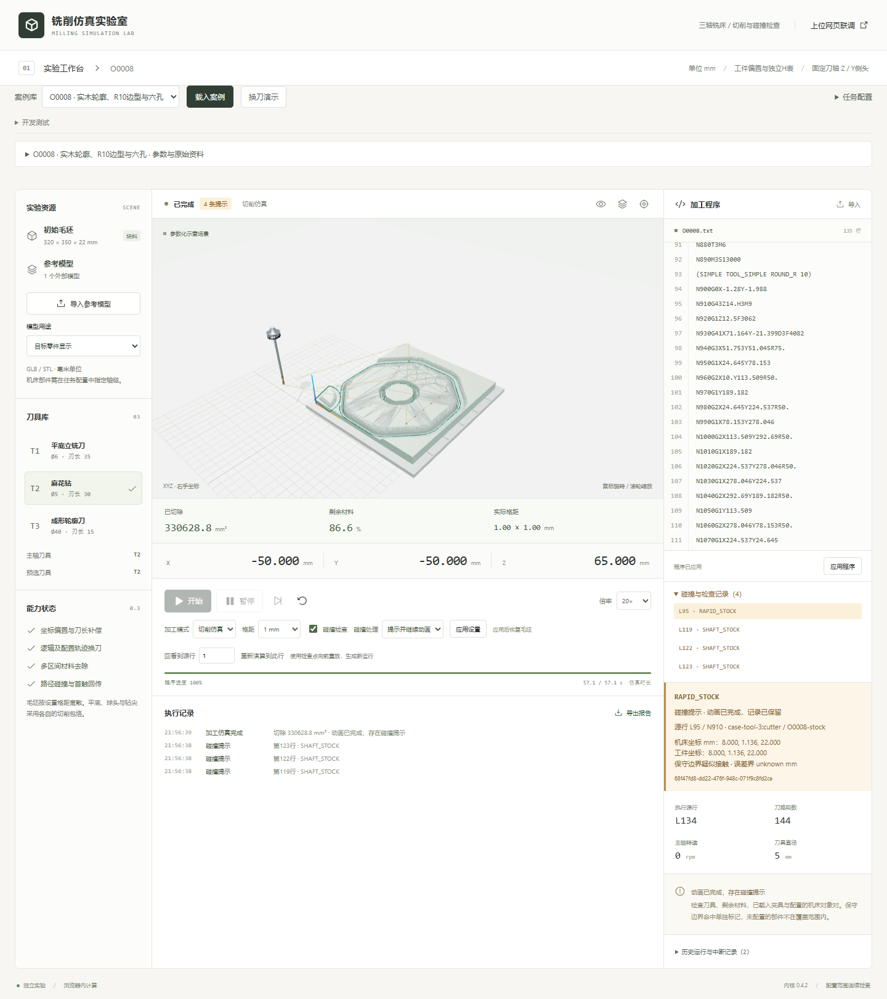

# 碰撞提示与连续动画（0.4.2）

根据用户要求，优先播放完整加工动画，碰撞另行提示。案例库与独立换刀演示默认选择“提示并继续动画”。“碰撞即暂停”继续保留，用于检查首触位置；开发测试仍默认暂停。切换选项后点击“应用设置”，会重新初始化材料和执行状态。

## 用户可见行为

- 发生碰撞时，不自动中断提示模式的刀路、切削显示或后续换刀。右侧记录碰撞类型、物理行、N行号、对象、接触坐标和保守误差标签。
- 画面上方显示提示数量。侧栏列出所有已记录的提示，点击可定位原代码行和对应三维接触标记，运行中不会因新提示反复抢夺编辑器焦点。
- 动画执行结束时，进度到100%，state=COMPLETED；若存在任何碰撞，verification仍为collision_detected，界面明确显示“动画已完成，存在碰撞提示”。
- 重置清空当前记录。回看源行时恢复已执行前缀的碰撞记录，新运行使用新的事件ID，原运行记录和ACK不变。

## 参数与协议

Job.simulation.stopOnCollision 为可选布尔值：

| 参数 | 行为 |
| --- | --- |
| false | 检测并提示碰撞，继续动画 |
| true或省略 | 首触碰撞暂停，保留原API默认行为 |
| checkCollisions=false | 关闭检查，verification=not_checked；与提示模式不同 |

九案例任务显式下发false，所以宿主页“下发案例”与独立工作台使用相同行为。外部上位网页可在完整Job中下发该参数。capabilities.collisionResponses提供pause和warn_continue。

COLLISION事件保留原协议类型、source、contact、eventId、eventSeq、requiresAck，新增response=warn_continue或pause。提示模式也持久保存并要求ACK，ReliableEventStore不会将提示事件误认为暂停。单次Worker更新可能包含多条提示，页面逐项发送；GET_REPORT.collisions和state.incidents保留全部已记录事件，宿主不能只依赖最后一条incident。

COMPLETED与碰撞结论分别读取：COMPLETED表示原程序执行结束，不意味着verification=fully_checked。有提示的报告保持collision_detected；碰撞的保守分类和unknown位置误差不会被改成精确接触。

## 计算范围

提示模式按Instruction记录首次接触。同一Instruction的后续对象对接触不继续枚举，后续Instruction恢复碰撞检查；coverage.warningScope=first_contact_per_instruction明确说明该范围。一条原G代码可展开多个Instruction，因此同一物理行可能有多条不同子动作提示。

碰撞后的运动和材料为原刀路教学显示，不计算撞击、变形、断刀或真实碰撞后的成品。有效主轴方向下的进给仍按既有刀形去料；G0、停转或方向错误的动作即使继续运动也不去料。正常空运行不去料。

软限位与碰撞响应分开：同段碰撞已提示后，后续越程仍可停止。查询无法确定、非法输入、材料资源错误也仍停止，不将计算失败包装成动画成功。用户主动暂停及M0/M1仍按原语义处理。

M6夹紧时照常检查新刀装夹。提示模式同时记录夹紧碰撞并完成换刀事件，继续后续程序；暂停模式先停机，不发送成功换刀事件。刀库装饰机构的运动仍未加入碰撞检测。

## 本轮验证

34个文件347项单元测试、24项真实Edge端到端与生产构建通过。新测试验证不同倍率、同动作去重、G0不去料、后续有效切削、初始重叠、M6装夹、主动暂停/单步、checkpoint前缀和新事件ID、越程、无法确定、可靠状态及iframe多事件ACK。

九案例提示模式均执行完成；暂停模式继续保持原来5例完成、4例停机的回归预期。真实浏览器O0008已执行到M30/物理行134、100%，累计4条提示：L95/N910 RAPID_STOCK，L119/N1150、L122/N1170、L123/N1180 SHAFT_STOCK。没有改写原程序或关闭检查。

`node tools/capture-collision-warning.mjs`复现桌面/860px截图与[执行证据](collision-warning-evidence.json)。截图中选择L95，所以代码和标记显示原接触，当前执行位置则已到程序终点。

