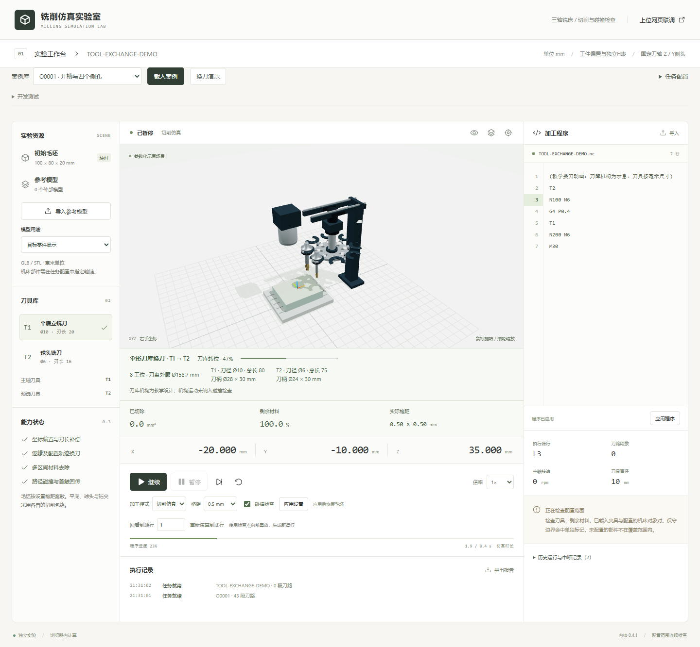

# 换刀动画与刀库尺寸

2026-10-18，版本 0.4.1。运行 `npm run dev`，打开 http://127.0.0.1:8786/，点击顶部独立的“换刀演示”按钮，载入后开始。原案例的不同刀号 M6 也会触发动画。预选 T 不换刀，同刀 M6 不播放虚假交换。其他功能测试样例已收进默认折叠的“开发测试”。

## 结构依据

采用伞形刀库的滑移刀盘结构：带开口刀套的水平转盘沿滑轨进出主轴，主轴抬离后才转位，送入新刀后夹紧并退出刀盘。没有把侧挂双臂换刀机构混入同一套机构。

- [Haas 刀库维修手册：Umbrella Shuttle / Carousel](https://haascnc.com/service/online-manuals/mill-tool-changer---service-manual/tool-changer-overviews.html)：参考刀盘、滑移机构、立轴转位、弹簧刀套的结构和职责；已查看原厂结构图。当前绘制的驱动座不是精确的日内瓦机构模型。
- [开源 XATC Carousel](https://github.com/xpix/XATC/wiki/XATC-Carousel)：参考模块化圆盘与工位布置。该项目采用旋拧夹头的特殊方案，本项目没有照搬其装夹动作。
- [Avid CNC ATC Getting Started](https://www.avidcnc.com/support/instructions/atc/atcGettingStarted/)：按刀具、刀柄与装夹组件的完整装配检查净空。其特定直排架间距不作为本项目圆盘的通用尺寸。

以上为结构参考，没有导入第三方 CAD、网格或代码，也没有把教学设计标成厂商机型。当前 Job 只给刀柄直径、长度，未给 BT/HSK 接口、拉钉、键槽等实测 CAD；因此刀柄使用受参数约束的通用锥面、法兰、夹持槽、夹头外形。

## 尺寸规则（全部为 mm）

工具使用同一 `createToolModel`，主轴上的刀、待装刀和刀库中的刀均不改变缩放。刀径、刃长、刀杆直径、量规伸出长度、刀柄直径与长度直接读取任务参数。球头、118°钻尖、成形刀剖面及固定刀轴保留；刀刃上的螺旋槽仅为外观细节，不替代切削算法。刀柄的所有顶点位于配置的圆柱碰撞包络内。移除了旧模型中超出刀柄直径的装饰圆帽和伸出刀尖的圆球标记。

| 参数 | 计算/含义 |
| --- | --- |
| 工位数 N | 至少 8；竖直刀具数超过 8 时向上取 4 的倍数 |
| D | 所有竖直工具中，刀刃、刀杆、刀柄的最大直径，最低设计基值 12 |
| 相邻工位中心距 P | D + 2 × (4 mm 刀套壁余量 + 0.35 mm 倒角) + 10 mm 净距 |
| 工位分布半径 R | P / (2 × sin(π/N)) |
| 刀盘外廓直径 | 2 × (R + D/2 + 4 + 0.35)，包括开口刀套，不包括滑轨和支架 |
| 滑移行程 | D + 24，教学设计值 |
| 主轴脱离行程 | 两把刀柄长度的较大值 + 14，教学设计值 |
| 刀具显示总长 | gaugeLengthMm + holder.lengthMm |

演示任务：T1 刀径 10、刃长 20、伸出 50、刀柄 Ø28×30，总长 80；T2 刀径 6、刃长 16、伸出 45、刀柄 Ø24×30，总长 75。计算结果 N=8、P=46.7、R≈61.02、刀盘外廓 Ø158.7。界面同时显示两把刀的实际尺寸及计算外廓。放大刀具参数时，刀库随包络扩大；通过改变相机取景容纳机构，不改变物体尺度。

上述净距和结构厚度是本教学模型的设计假设，不是某品牌刀库规格。没有机床 CAD 时不能据此保证机床内部安装空间。固定 -Y 侧头不放入竖直刀套；涉及侧头的换刀使用单独组件装卸示意，明确提示需要专用适配机构。

## 执行与接口

不同刀号 M6 在 Worker 中产生 4000 ms 教学交换周期，阶段为松刀、取旧刀、刀库转位、送新刀、夹紧。这个周期计入 elapsedMs / totalMs，**不代表真实机床换刀节拍**。配置的 XYZ 接近和返回路径仍分别执行。

渲染器只消费 Snapshot.toolExchange 的 instructionId、source、fromTool、toTool、oldTip、newTip、progress、phase、phaseProgress、illustrative，无独立计时器。暂停冻结机构姿态，恢复沿原进度继续，倍率作用于仿真时间，重置清空动画。源行单步完成整个 M6 源块，不逐帧播放。

夹紧结束前，activeTool 和实际刀尖保持旧刀。结束时先切换新刀并检查装夹位置，TOOL_CHANGE保持原M6物理行、N行号和instructionId。暂停模式下装夹碰撞进入PAUSED_COLLISION，不发送成功换刀事件；0.4.2提示模式记录同一源行碰撞，同时完成教学换刀并继续后续动画，verification保持collision_detected。两种方式详见[碰撞提示模式](collision-warning.md)。

capabilities.toolChangeAnimation 声明 illustrative / 4000 ms / configured_xyz_and_clamp_only。刀盘、滑轨、支架、主轴示意件及其渲染位移**未加入碰撞计算**。当前 fully_checked 仍仅指报告 coverage 中声明的刀具、材料、夹具和配置机床对象对，不能据动画宣称完整换刀机构无碰撞。要做实机级换刀检查，需要下发真实机构模型、运动与接触排除配置。

## 验证与截图

最终326项单元、19项真实Edge端到端及生产构建通过。本轮新增测试覆盖 Worker 时序、暂停/恢复/倍率/重置/单步、预选与同刀、装夹碰撞源行、刀套净距与自动扩容、阶段姿态连续性、侧头分支，以及四种刀具的毫米包络。还检查4mm短刀柄、150mm长刀柄的实际刀套/主轴网格边界及文字纹理释放。真实 Edge 测试覆盖可见动画、尺寸文本、暂停冻结及完成事件。

桌面与窄屏截图由 `node tools/capture-tool-exchange.mjs` 生成，证据写入 `tool-exchange-evidence.json`；截图只用于核对实际显示，不能替代机构运动碰撞证明。

