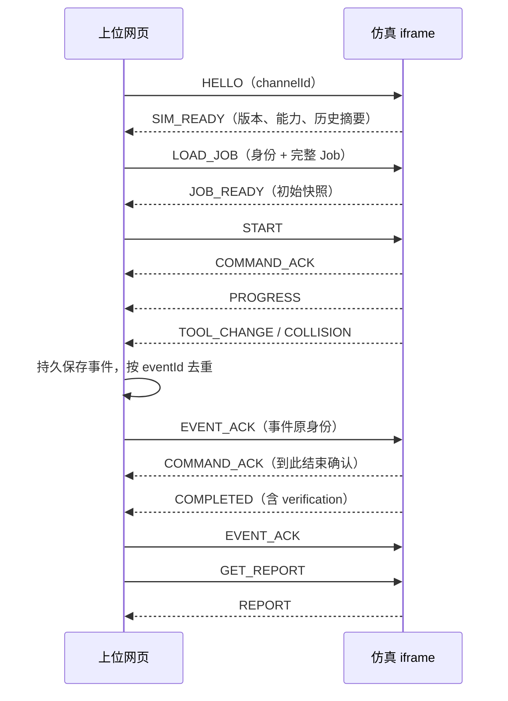

# 三轴铣床仿真系统：上位机通讯接口手册

适用软件版本：0.5.0；通讯协议：`cnc-sim / 1.0`。本文以本仓库实现为准，面向嵌入仿真页面的上位网页开发者。

本文中的“上位机”指业务网页。业务网页通过 iframe 嵌入仿真工作台，使用 `window.postMessage` 下发 G 代码、刀具、毛坯及模型，接收进度、换刀、碰撞和报告。几何与切削运算在仿真页的 Web Worker 中执行。当前接口不提供 HTTP 上传服务、WebSocket 服务或实体机床控制通道；HTTP(S) 用于访问页面和模型资源。

## 目录

1. [接入与运行示例](#1-接入与运行示例)

2. [消息信封与身份](#2-消息信封与身份)

3. [命令与应答](#3-命令与应答)

4. [任务数据 Job](#4-任务数据-job)

5. [模型、刀具与机床配置](#5-模型刀具与机床配置)

6. [状态、进度与换刀动画](#6-状态进度与换刀动画)

7. [碰撞、源行与坐标回传](#7-碰撞源行与坐标回传)

8. [事件确认、重试与中断历史](#8-事件确认重试与中断历史)

9. [报告与输入追溯](#9-报告与输入追溯)

10. [部署与故障排查](#10-部署与故障排查)

11. [联调验收清单与实现索引](#11-联调验收清单与实现索引)

## 1. 接入与运行示例

### 1.1 本地运行

在项目目录执行：

```powershell
npm ci
npm run dev
```

打开 [通讯示例页](http://127.0.0.1:8786/examples/host-integration/index.html)，依次点击“连接 → 下发任务 → 应用倍率 → 开始”。示例任务包含两把刀、M6 换刀和材料切削；“获取报告”显示完整结果。“可选 GLB/STL 文件”可下发成品参考或夹具。

配套文件：

| 文件                                                                  | 用途             |
| ------------------------------------------------------------------- | -------------- |
| [index.html](../examples/host-integration/index.html)               | 可直接运行的纯网页上位机示例 |
| [cnc-sim-client.js](../examples/host-integration/cnc-sim-client.js) | 无框架依赖的参考通讯适配器  |
| [sample-job.json](../examples/host-integration/sample-job.json)     | 完整双刀任务         |
| [现有联调页面](http://127.0.0.1:8786/host.html)                           | 案例下发、模型和故障联调   |

示例需通过 HTTP(S) 访问，不能双击以 `file://` 运行。自 0.5.0 起，`npm run build` 同时构建工作台、`host.html` 和 `examples/host-integration/index.html`，完整部署 dist 后即可访问示例。任务 JSON 使用独立资源，兼容部署模板的 CSP。参考适配器用于解释协议；正式业务应接入自己的事件存储、日志和界面。

### 1.2 最短接入代码

将参考适配器与任务 JSON 放在上位网页可访问的位置：

```html
<iframe id="cnc" title="机床仿真" style="width:100%;height:900px"></iframe>
<script type="module">
import { CncSimClient } from './cnc-sim-client.js';

const client = new CncSimClient(
  document.querySelector('#cnc'),
  'http://127.0.0.1:8786/index.html?instanceId=lesson-001',
  {
    onMessage(message) {
      if (message.type === 'PROGRESS') console.log('进度', message.payload.progress);
    },
    onEvent(message) {
      if (message.type === 'COLLISION') {
        console.log('碰撞', message.payload.source.physicalLine, message.payload.contact);
      }
      if (message.type === 'COMPLETED') {
        console.log('动画完成，检查结论：', message.payload.verification);
      }
    },
    onError(error) { console.error(error); }
  }
);

await client.connect();
const job = await (await fetch('./sample-job.json')).json();
await client.loadJob(job, { jobId: 'lesson-001', revision: 1 });
await client.setSpeed(5);
await client.start();
// 结束时：const report = (await client.getReport()).payload;
// 重置时：await client.reset(); 后续请求使用适配器更新后的 runId。
</script>
```

跨域时，先按第 10 节配置仿真页允许的父网页来源。示例中的默认事件存储为上位网页 `localStorage`，先保存再 ACK；存储失败会提示错误并保留未确认事件。生产可替换 `persistEvent(message)` 为服务端存储：保存成功返回 `true`，已存在返回 `false`，失败抛出异常。

### 1.3 适配器生命周期与 TypeScript

参考适配器的 loadJob/start/pause/resume/step/reset/seekLine/setSpeed/getState/getReport 自动排队，连续调用也会在前一应答后读取最新 runId。原始 request() 保留底层请求语义，业务自行管理依赖关系。排队任务在 iframe 重载或 dispose 后取消，不跨页面重放。

connect() 首次及重复调用统一返回 SIM_READY 信封，ready 属性仍为能力 payload。可配置 onConnectionChange(state)，状态为 disconnected、connecting、connected、disposed。重载后自动重新握手，15秒无应答结束重试；任务与材料不会自动恢复。dispose() 可重复调用，但已释放实例不能再次连接；需创建新实例。尚在保存中的事件可以完成存储，但释放/重载后不再确认或派发该旧事件。

SDK本地检查命令、对象payload、身份、倍率/源行和请求选项；request的timeoutMs范围为1～120000，retries为0～3整数。可结构化克隆失败也以Promise拒绝。onMessage/onEvent/onConnectionChange的同步及异步异常交给onError，日志回调异常被隔离。无eventId的关键故障仍传onEvent但不ACK；delivery.durable=false会另以EVENT_PERSISTENCE_FAILED通知onError。

TypeScript接入可将 [cnc-sim-client.d.ts](../examples/host-integration/cnc-sim-client.d.ts) 放在JS文件旁；声明无需依赖本仓库src。[typed-host.ts](../examples/host-integration/typed-host.ts) 提供第三方父页面接入函数。详细碰撞/报告结构仍以本手册和运行数据为准。

工作台“导出碰撞CSV”可导出全部已记录事件，含任务身份、源行/N号/原文/SHA、对象、机床/工件坐标、误差与响应。无接触点留空，unknown按原值保留；JSON报告仍为完整归档依据。

### 1.4 通讯顺序



仿真页等待 `HELLO`，不保证主动发送就绪通知。父网页应在 iframe `load` 后发送握手，未收到就绪时适度重试。参考适配器每 400 ms 重试握手，15 秒后报超时。

## 2. 消息信封与身份

所有消息都是可结构化克隆的 JavaScript 对象，不是 JSON 字符串：

```json
{
  "protocol": "cnc-sim",
  "version": "1.0",
  "type": "START",
  "messageId": "9d2a8af4-85e2-4cd6-b244-cb99131d648a",
  "channelId": "host-session-20261018",
  "jobId": "lesson-001",
  "revision": 1,
  "runId": "c35e2011-65ae-41f1-985a-1705a2732628",
  "payload": {}
}
```

| 字段                 | 规则与含义                            |
| ------------------ | -------------------------------- |
| protocol / version | 固定 `cnc-sim` / `1.0`；软件版本与协议版本不同 |
| type               | 命令或事件名，区分大小写                     |
| messageId          | 每个新请求的唯一非空字符串，最长 128 字符，建议 UUID  |
| channelId          | 本次父页面会话 ID，8～128 字符；握手后绑定来源与通道   |
| jobId              | 业务任务 ID，非空，最长 128 字符             |
| revision           | 任务修订，正安全整数；相同 jobId 重新载入需递增      |
| runId              | 本次运行 ID，非空，最长 128 字符；与任务修订共同隔离运行 |
| payload            | 必须是对象，空参数使用 `{}`；不能是数组、null 或字符串 |
| replyTo            | 应答携带原请求 messageId，父网页据此关联请求      |

`HELLO`、`PING` 不需要任务身份。其余命令，包括 `GET_STATE`、`GET_REPORT`、`EVENT_ACK`，都必须携带完整的 `jobId / revision / runId`。

父网页接收消息必须同时验证：

```js
if (event.origin !== simOrigin) return;
if (event.source !== iframe.contentWindow) return;
const m = event.data;
if (m?.protocol !== 'cnc-sim' || m.version !== '1.0') return;
if (m.channelId !== channelId) return;
```

发送时使用 `iframe.contentWindow.postMessage(message, simOrigin)`；`simOrigin` 为精确来源，如 `https://sim.example.edu`，不能使用 `*`。仿真页也会验证来源和父窗口。多个 iframe 使用不同 channelId，并在 URL 中设置不同 `instanceId` 隔离本地历史存储。

### 身份更新规则

1. 首次 `LOAD_JOB`：父网页生成 jobId、revision、runId。

2. 改程序、刀具、模型或仿真配置后重新载入：同 jobId 的 revision 递增，生成新 runId。

3. `RESET`、`SEEK_LINE`：请求携带当前身份；仿真页生成新 runId，通过应答顶层返回。等待应答、更新身份后再发送控制命令。revision 不变。

4. 旧事件的 ACK 始终使用该事件原始身份，即使当前运行已重置。

5. 同一 iframe 完成握手后不能直接换 channelId；需要更换会话时重新载入 iframe。

对相同 jobId 的修订检查在当前会话中保留，切到其他任务再切回也不能复用旧 revision。建议业务系统自己管理修订号。

## 3. 命令与应答

下表 payload 是信封中的 `payload` 字段。除特别说明，空参数均使用 `{}`。

| 命令                                          | 请求 payload                 | 成功应答        | 行为                                                     |
| ------------------------------------------- | -------------------------- | ----------- | ------------------------------------------------------ |
| HELLO                                       | `{}`                       | SIM_READY   | 返回 engineVersion、capabilities、history、persistenceError |
| PING                                        | `{}`                       | PONG        | 握手后连通性探测，不代表仿真正在运行                                     |
| LOAD_JOB | **完整 Job 本身** | JOB_READY        | 载入、校验模型和程序；不是 `{job: Job}` |             |                                                        |
| START                                       | `{}`                       | COMMAND_ACK | 从 READY 开始                                             |
| PAUSE                                       | `{}`                       | COMMAND_ACK | 暂停执行和换刀动画                                              |
| RESUME                                      | `{}`                       | COMMAND_ACK | 从普通 PAUSED 恢复                                          |
| STEP                                        | `{}`                       | COMMAND_ACK | 在 READY / PAUSED 按原始程序块单步                              |
| RESET                                       | `{}`                       | STATE       | 恢复初始材料，生成新 runId                                       |
| SEEK_LINE                                   | `{"physicalLine":95}`      | STATE       | 回放演算到指定原始物理行，生成新 runId                                 |
| SET_SPEED | `{"speed":5}` | COMMAND_ACK     | 倍率 0.25～20，可为小数            |             |                                                        |
| GET_STATE                                   | `{}`                       | STATE       | 当前快照及可靠事件历史信息                                          |
| GET_REPORT                                  | `{}`                       | REPORT      | 当前报告或已保存的历史运行记录                                        |
| EVENT_ACK | `{"eventId":"…"}` | COMMAND_ACK | 确认该原始身份的关键事件               |             |                                                        |

`JOB_READY.payload` 包含 `{state: Snapshot, capabilities, jobId, revision, runId}`。控制命令的 `COMMAND_ACK.payload`、重置/回看返回的 `STATE.payload` 包含 `{state: Snapshot, ...identity}`。`EVENT_ACK` 的应答例外，仅含 `{eventId}`。

**PROGRESS 与 COMPLETED 的 payload 直接是快照，不包一层 state 对象。** 例如 `PROGRESS.payload.state === 'RUNNING'`，而 `GET_STATE` 的应答是 `STATE.payload.state.state === 'RUNNING'`。

在 RUNNING / TOOL_CHANGING 时先暂停，再 `LOAD_JOB` 或 `SEEK_LINE`。暂停碰撞状态不能直接 RESUME；可修改任务重新下发、重置，或预先选择提示模式。不要并发发送依赖前一命令身份或状态的命令；使用 `await` 串行处理。

### 错误应答

```json
{
  "protocol":"cnc-sim", "version":"1.0", "type":"COMMAND_ERROR",
  "messageId":"reply-001", "replyTo":"request-001", "channelId":"host-session-20261018",
  "jobId":"lesson-001", "revision":1, "runId":"current-run",
  "payload":{"code":"STALE_RUN","message":"任务版本已失效"}
}
```

payload 为 `{code, message, physicalLine?}`。常见 code 有 `INVALID_INPUT`、`STALE_RUN`、`STALE_REVISION`、`MESSAGE_CONFLICT`、`UNKNOWN_EVENT`、`HASH_MISMATCH`、`COMMAND_ERROR`。运行故障可能另外产生异步 `ERROR` 或 `INDETERMINATE`，不能只处理 COMMAND_ERROR。Worker 异常转译后不保证保留全部内部细分错误码，应同时记录 message。

来源、父窗口、通道或基础信封不合法时可能直接丢弃，不保证收到错误应答。超时不等于命令未执行，也不等于已取消；先查询状态或报告对账。

## 4. 任务数据 Job

完整可运行任务见 [sample-job.json](../examples/host-integration/sample-job.json)。以下字段按 JavaScript 对象传入：

| 字段                    | 必填 | 说明                                                                     |
| --------------------- | -- | ---------------------------------------------------------------------- |
| program               | 是  | `{programId, text, sha256?, lineEnding?}`，text 为原始 G 代码字符串             |
| stock                 | 是  | 块料 `{objectId,kind:'box',sizeMm:[X,Y,Z],minCornerInW:[X,Y,Z]}`；网格毛坯见下节 |
| tools                 | 是  | 1～32 把刀，T 号唯一；定义见第 5 节                                                 |
| initialPositionMm     | 否  | 初始参考刀尖坐标 `[X,Y,Z]`，单位 mm；缺省 `[0,0,30]`，建议显式传入                          |
| assets                | 否  | 模型资源数组，默认 `[]`                                                         |
| dialectId             | 否  | 默认 `milling-basic-v1`；兼容旧 `milling-preview-v1`                         |
| initialAxisPositionMm | 否  | 初始实际轴位置 `{x,y,z}`；配置机床时用于轴坐标初始化                                        |
| workOffsetsMm         | 否  | G54～G59 的平移偏置，例如 `{"G54":{"x":0,"y":0,"z":20}}`                        |
| toolLengthOffsetsMm   | 否  | 独立 H 长度表，例如 `{"1":50,"2":45}`，H 不自动等于 T                                |
| toolLengthReferenceMm | 否  | 长度补偿参考值，默认 0，范围 0～600 mm                                               |
| cutterRadiusOffsetsMm | 否  | 独立 D **半径**表，例如 `{"1":5}`，不是直径                                         |
| machineProfile        | 否  | 实际轴链、行程、换刀路径及机床对象配置                                                    |
| machineProfileId      | 否  | 内置配置标识 `vmc-xyz-demo-v1`；实际机床建议显式配置                                    |
| optionalStop          | 否  | 是否启用 M1，默认 false                                                       |
| simulation            | 否  | 仿真模式、碰撞处理与精度配置                                                         |

程序上限 512000 个 JavaScript 字符、20000 物理行。`sha256` 可省略，由系统按精确 UTF-8 文本计算；传入时应为 64 位小写十六进制且匹配原文。不要在计算摘要后删除 BOM、统一换行或删空行。`lineEnding` 最终由系统从真实文本推导，传入值不会改写程序换行。

块料三边范围分别为 0.1～1000 mm，坐标在 ±1000000 mm 内。网格单元数 `ceil(X/cell) × ceil(Y/cell)` 不得超过 160000；更细精度可能使任务超限，系统会明确拒绝。对象 ID 应在刀具、毛坯、模型和模型节点之间保持唯一。`preparedMeshes` 是系统内部派生数据，宿主不要直接构造。

### 4.1 仿真参数

```json
{
  "stockCellMm":0.5,
  "arcChordToleranceMm":0.02,
  "mode":"cut",
  "checkCollisions":true,
  "stopOnCollision":false,
  "contactLocalizationMm":0.05,
  "maxCollisionQueries":200000,
  "maxMemoryMb":512
}
```

| 参数                    | 默认值      | 范围或含义                               |
| --------------------- | -------- | ----------------------------------- |
| stockCellMm           | 0.5      | 0.1～5 mm，材料 XY 格距                   |
| arcChordToleranceMm   | 0.02     | 0.001～0.1 mm，圆弧材料逼近误差               |
| mode                  | cut      | `cut` 去料；`dry_run` 不去料，仍可检查碰撞       |
| checkCollisions       | true     | false 时结论为 not_checked              |
| stopOnCollision       | **true** | false 为“提示并继续动画”；省略保留原暂停行为          |
| contactLocalizationMm | 0.05     | 0.001～0.05 mm，首触路径区间定位目标            |
| maxCollisionQueries   | 200000   | 100～1000000，检查预算；耗尽产生 INDETERMINATE |
| maxMemoryMb           | 512      | 64～1024，估算分配预算，不是浏览器进程峰值保证          |

当前案例库显式设置 `stopOnCollision:false`；外部宿主下发任务时也应显式选择。提示模式仅允许碰撞后继续，越程、无法确定和计算故障仍停止。完整边界见 [碰撞提示说明](collision-warning.md)。

## 5. 模型、刀具与机床配置

### 5.1 模型资源 Asset

```js
job.assets.push({
  objectId: 'fixture-01', role: 'fixture', format: 'stl', unit: 'mm',
  buffer: await file.arrayBuffer(),
  poseInM: { translationMm: [0, 0, 0], quaternionXYZW: [0, 0, 0, 1] }
});
// 也可将 buffer 替换为 url: 'https://assets.example.edu/fixture.stl'
await client.loadJob(job, { jobId: 'lesson-001', revision: 2 });
```

| 字段           | 规则                                                     |
| ------------ | ------------------------------------------------------ |
| objectId     | 模型对象唯一 ID，碰撞回传引用此 ID                                   |
| role         | `stock` 初始毛坯；`target` 成品参考；`fixture` 夹具；`machine` 机床部件 |
| format       | `glb` 或 `stl`；GLB 需自包含资源                               |
| unit         | `mm` 或 `m`，先换算模型单位，再旋转、平移                              |
| buffer / url | 二选一：原始 ArrayBuffer，或绝对 HTTP(S) URL                     |
| sha256       | 可选，模型原始字节的 SHA-256                                     |
| poseInM      | translationMm 三元素、quaternionXYZW 四元素；四元数需归一化           |
| nodes        | 可选 `[{nodeName,objectId,role}]`，用于 GLB 节点映射，最多 200 项   |

资源最多 20 个；单个最多 32 MiB，总字节最多 64 MiB。碰撞对象最多 200000 三角面，显示总面数最多 1000000；还受几何与内存预算限制。闭合网格毛坯会执行有效性检查。

`target` 仅供对照显示，不参与材料去除或障碍物碰撞。`fixture` 作为障碍物。`stock.kind:'mesh'` 时 `stock.assetId` 指向 role 为 stock 的模型，模型需要有效闭合，系统根据网格计算材料边界。`machine` 的运动和检查覆盖还需 machineProfile 配置。

不能传本地 `F:\…` 路径，也不能把 File 对象直接当 buffer。页面“完整任务 JSON”里的 `{$arrayBuffer:"base64…"}` 是本地文件读写格式，**LOAD_JOB 不会自动解码此包装**；宿主需先还原 ArrayBuffer。带二进制的任务直接传对象，不要 JSON.stringify。参考适配器发送时不使用 transfer list，避免重试时 buffer 已被转移。

URL 模型由仿真 iframe 获取，模型服务器的 CORS 必须允许**仿真页面来源**。当前 Asset 没有自定义请求头接口；需要鉴权时由业务系统设计同源资源或短期签名 URL，避免在日志中暴露凭据。

### 5.2 刀具 Tool

```json
{
  "toolId":"tool-01", "toolNumber":1, "type":"flat_endmill",
  "diameterMm":10, "cuttingLengthMm":20, "gaugeLengthMm":50,
  "shaftDiameterMm":10, "holder":{"diameterMm":28,"lengthMm":30},
  "requiredSpindleDirection":"CW", "axisDirection":{"x":0,"y":0,"z":1}
}
```

| 参数                           | 约束                                              |
| ---------------------------- | ----------------------------------------------- |
| toolNumber                   | 整数 1～9999，任务内唯一，与 T 指令对应                        |
| type                         | flat_endmill、ball_endmill、drill、profile_endmill |
| diameterMm / shaftDiameterMm | 0.1～200 mm                                      |
| cuttingLengthMm              | 0.1～300 mm；球头刃长需容纳球半径，钻头需容纳 118°钻尖              |
| gaugeLengthMm                | 不小于刃长，最大 600 mm                                 |
| holder.diameterMm / lengthMm | 各 0.1～300 mm                                    |
| requiredSpindleDirection     | CW 默认，或 CCW                                     |
| axisDirection                | 默认 +Z；另支持固定 -Y 侧头，不支持任意摆角                       |
| radialProfile                | 成形刀必需，2～128 个 `{zMm,radiusMm}` 点                |

成形刀剖面 z 从 0 到刃长严格递增，半径非递减，最大半径等于 diameterMm/2。仅支持 +Z 及等 Z 的 XY / 纯 Z 切削，混合斜向切削会报错。成形刀碰撞凸包命中可能返回 potential_collision 与未知误差，不能按精确非凸刀形解释。

换刀不需要单独“播放动画”命令。T 预选，M6 实际换刀并停主轴；新刀尺寸来自上述刀表。教学刀库以真实毫米尺寸布置刀位，4 秒示意动作随暂停和倍率控制。刀库外观机械手不属于已验证的整机碰撞覆盖。

### 5.3 机床配置 MachineProfile

完整结构见 [machineTypes.ts](../src/core/machineTypes.ts)，配置例见 [scenarios.ts](../src/lib/scenarios.ts)。主要字段：

| 字段                                               | 说明                                                                    |
| ------------------------------------------------ | --------------------------------------------------------------------- |
| axes.x/y/z                                       | 各含 direction（±1）、carrier（tool/table）、zeroMm、minMm、maxMm，可配置 parent 父轴 |
| rapidRateMmMin                                   | 快移速度，默认教学配置 6000 mm/min                                               |
| rapidMode                                        | linear 或 axis_sequential；后者可配置 rapidAxisOrder                         |
| homeAxisPositionMm / secondaryHomeAxisPositionMm | G28 / G30 参考轴位置；使用相应指令时需显式提供                                          |
| toolChange                                       | mode 为 logical / configured；configured 提供 waypointsMm 与 returnToStart |
| components                                       | `[{objectId,drivenBy:['x','y']}]`，模型部件随轴运动                            |
| collisionPairs                                   | 明确配置机床部件对象对 `[[id1,id2]]`                                             |
| collisionExclusions                              | `{objects:[id1,id2],stages?:[...]}` 排除规则，需按真实机构审核                     |

configured 换刀 waypointsMm 为实际机床轴/安装参考路径，不能当作刀尖坐标直接填写。进站、返回和装夹检查归属原 M6 源行。无模型、轴链或对象对时，报告不会自动获得整机检查覆盖。

当前实现为固定 +Z / -Y 刀轴的三轴平移。支持 G0/1/2/3、G17、G20/21、G90/91、G94、G54～59、G53、G43/49、G92、G41/42/40、G15/16、G81、G28/30、T/M6、主轴/冷却/暂停/结束等已声明方言；宏、五轴、其他固定循环等不应直接下发。详细约束见 [README 坐标和方言](../README.md#坐标和方言)。

## 6. 状态、进度与换刀动画

| state            | 含义与宿主处理                            |
| ---------------- | ---------------------------------- |
| IDLE / LOADING   | 无就绪任务 / 载入中；等待 JOB_READY           |
| READY            | 可以 START 或 STEP                    |
| RUNNING          | 普通仿真执行中                            |
| TOOL_CHANGING    | 换刀动画中，可 PAUSE、调速                   |
| PAUSED           | 用户、程序 M0/M1 或后台可见性导致暂停，可 RESUME    |
| PAUSED_COLLISION | 碰撞暂停；不得直接当普通暂停恢复                   |
| INDETERMINATE    | 检查预算或证明不足，不能形成通过结论                 |
| COMPLETED        | 程序执行至 M2/M30 或结束；仍须读取 verification |
| ERROR            | 输入或执行故障，显示错误并停止自动控制                |

PROGRESS 约每 100 ms 至多一次，具体随浏览器和负载变化，不是固定周期心跳；暂停时可能不发送。网页进入后台会触发自动暂停，返回后由用户或宿主明确恢复。

快照常用字段：

| 字段                              | 含义                                                     |
| ------------------------------- | ------------------------------------------------------ |
| state / verification            | 执行状态 / 检查结论，必须分别保存                                     |
| position                        | 参考框架中的刀尖 `{x,y,z}`，不等于所有机床配置下的物理 M 点                   |
| axisPosition                    | 实际 XYZ 轴位置                                             |
| physicalLine / instructionIndex | 原始物理行 / 内部指令索引，不能混用                                    |
| progress                        | 0～1；展示百分比需乘 100                                        |
| elapsedMs / totalMs / speed     | 仿真时间、预计总仿真时间、倍率；包含教学换刀时间                               |
| activeTool / selectedTool       | 当前主轴刀具 / T 预选刀具，M6 前可能不同                               |
| spindleRpm / spindleOn          | 主轴状态                                                   |
| stock                           | 网格格距、初始/切除/剩余体积（mm³）、remainingFraction（0～1）            |
| coverage                        | 方法、对象对、机床部件、碰撞响应和 warningScope                         |
| toolExchange                    | fromTool/toTool、总进度、phase、phaseProgress、illustrative 等 |

toolExchange.phase 依次为 release、remove_old、index_magazine、insert_new、clamp。`TOOL_CHANGE` 关键事件表示换刀记录，包含 toolNumber、physicalLine、instructionId、capability、contactStage；动画逐帧状态从快照读取。快照中的 events 不是完整事件历史，不能替代可靠事件通道。

verification 为 not_checked、in_progress、fully_checked、collision_detected、indeterminate。只有完成声明覆盖且没有碰撞/不确定时才可得到 fully_checked。**COMPLETED + collision_detected 表示动画执行完成且检测到碰撞，不能显示“校验通过”。**

## 7. 碰撞、源行与坐标回传

### 7.1 提示模式

设置 `simulation.checkCollisions:true`、`simulation.stopOnCollision:false`，碰撞会生成 COLLISION，保留位置与源行，动画继续。每个内部 Instruction 仅记录首次接触，该段余下部分不穷举其他接触；后续 Instruction 重新检查。`coverage.warningScope` 为 first_contact_per_instruction。一行 G 代码可能展开多个 Instruction，因此不能按“一行最多一个碰撞”处理。

G0、停转或主轴方向不符时接触材料，即使继续动画也不会按有效切削去料。碰撞后的动画用于观察后续程序，不模拟撞坏、变形或真实事故后的成品。LIMIT、INDETERMINATE、ERROR、M0/M1 和主动暂停仍按各自规则处理。

### 7.2 事件字段

COLLISION、LIMIT、INDETERMINATE 的 payload 包含以下数据；具体可选项以事件为准，不应假设每类都有接触点：

| 字段                                     | 解释                                                                     |
| -------------------------------------- | ---------------------------------------------------------------------- |
| type / collisionType                   | 事件类型与原因，例如 COLLISION / RAPID_STOCK                                     |
| classification                         | confirmed_collision、potential_collision、limit、indeterminate            |
| objects                                | 参与检查的刀具/毛坯/夹具/机床对象信息，保留原始结构                                            |
| source                                 | 源程序关联信息，见下表                                                            |
| contact                                | 接触信息；LIMIT 或无可定位接触时为 null                                              |
| response                               | pause 或 warn_continue                                                  |
| simulationTimeMs                       | 仿真时间，单位 ms                                                             |
| contactStage                           | motion、initial_overlap、move_to_change、clamp_new、return_from_change 等阶段 |
| contactToolTipInM / lastSafeToolTipInM | 接触时与上次安全位置的刀尖 M 坐标                                                     |
| lastSafeVerified                       | false 时不能把 lastSafe 当作已经证明安全的位置                                        |
| contact.pathParameterBracket           | 首触所处的指令路径参数区间，不在 payload 顶层                                            |
| contact.positionErrorBoundMm           | 数值或字符串 `unknown`，保留不确定性，不在 payload 顶层                                  |
| eventId / eventSeq / delivery          | 可靠投递字段，见第 8 节                                                          |

source 字段：

| 字段                           | 使用方式                                |
| ---------------------------- | ----------------------------------- |
| physicalLine                 | **从 1 开始的原始文本行号**，空行和注释也计数；编辑器定位的主键 |
| blockNumber                  | N 段号；可为 null、可不连续，不等于 physicalLine  |
| sourceText                   | 原行内容，例如 `N910G43Z14.H3M9`           |
| programId / programSha256    | 程序标识与精确输入摘要，防止定位到已修改程序              |
| instructionId / segmentIndex | 内部展开指令/段索引，用于诊断，不用作编辑器行号            |

### 7.3 坐标解释

内部使用右手 XYZ 与 mm。模型 poseInM 的平移始终为 mm，即使模型 unit 为 m。工件偏置 G54～G59 为平移。

`contact.point` 是**物理机床 M 坐标中的障碍物见证点**，不是刀尖；`contact.pointInWork` 为对应源工件坐标，`contact.workFrame` 标明 G54 等框架。`contact.toolPoint` 是刀具侧见证点，normal 为障碍物指向刀具的法向。以上点和法向均为三元素数组 `[x,y,z]`。宿主三维标记应使用 point 并明确坐标系；若需显示刀尖使用 contactToolTipInM。

移动工作台机床下，Snapshot.position 与物理 M 接触点不能直接比较。材料单元代理、保守边界或成形刀凸包接触可能是 potential_collision；positionErrorBoundMm 为 unknown 时不要显示为“精确到 0.05 mm”。contactLocalizationMm 是路径定位目标，不是模型/材料误差的总保证。初始即重叠时可能 lastSafeVerified=false。

### 7.4 宿主显示与定位参考

```js
function showCollision(message, currentProgramSha) {
  const p = message.payload;
  const sameProgram = p.source.programSha256 === currentProgramSha;
  if (sameProgram) selectEditorPhysicalLine(p.source.physicalLine); // 从1开始
  // 页面函数由业务系统实现；不要通过 innerHTML 拼接 sourceText。
  appendIncident({
    eventId: p.eventId, runId: message.runId,
    line: p.source.physicalLine, n: p.source.blockNumber,
    type: p.collisionType, classification: p.classification,
    machinePointMm: p.contact?.point ?? null,
    workPointMm: p.contact?.pointInWork ?? null,
    errorBoundMm: p.contact?.positionErrorBoundMm ?? null,
    response: p.response
  });
}
```

上例为业务回调片段，selectEditorPhysicalLine / appendIncident 需由宿主实现。不中断动画的提示可使用列表、提示条和定位按钮；不要收到 COLLISION 就自行 PAUSE。收到 COMPLETED 后仍保留事件列表。

## 8. 事件确认、重试与中断历史

### 8.1 需要 ACK 的事件

仅 `COLLISION`、`LIMIT`、`INDETERMINATE`、`ERROR`、`TOOL_CHANGE`、`COMPLETED` 为关键事件；且存在有效 payload.eventId 时才发送 EVENT_ACK。PROGRESS、STATE、REPORT、SIM_READY、COMMAND_ACK 不确认。

关键事件增加 `eventId`、运行内递增的 `eventSeq`、`delivery`。仿真页先持久化再发送，未确认时重发原信封。宿主按 `(jobId, revision, runId, eventId)` 去重，先持久保存，再确认。重复消息仍需确认，但不重复弹窗或记账。eventSeq 是运行内事件序号，不是 G 代码行号。

```js
// 此片段表达确认规则；完整存储、串行化和校验见配套适配器。
await persistEventToYourDatabase(message); // 成功或已存在后才继续
iframe.contentWindow.postMessage({
  protocol:'cnc-sim', version:'1.0', type:'EVENT_ACK',
  messageId:crypto.randomUUID(), channelId:message.channelId,
  jobId:message.jobId, revision:message.revision, runId:message.runId,
  payload:{eventId:message.payload.eventId}
}, simOrigin);
```

EVENT_ACK 的 COMMAND_ACK 也含 eventId，**不能仅依据“含 eventId”再次 ACK**，否则会形成确认循环。接收确认应答后结束此次确认。

`delivery.durable:false` 或 persistenceError 表示仿真端持久化失效。宿主仍可保存已收到的数据，但不能声称仿真端具备可靠恢复能力。部分持久化故障 ERROR 可能没有 eventId，应直接记录错误而非盲目确认。

### 8.2 请求重试

同一个 messageId、完全相同的内容，会在缓存范围内返回相同应答且不重复执行；同 messageId 不同内容返回 MESSAGE_CONFLICT。当前缓存仅保留会话最近 64 个命令，不跨 iframe 重载，不提供无限期 exactly-once 保证。

超时重试需复用原 messageId 和原始完整内容；二进制模型也必须相同。超出缓存范围或 iframe 重载后，应查询对账，而非假设可以安全重发 START/RESET。参考适配器普通请求等待 15 秒、LOAD_JOB 等待 60 秒，各最多重试一次；业务可按任务大小调整，但超时不取消服务端工作。

若 RESET/SEEK_LINE 已执行但应答丢失，旧身份查询可能先收到 STALE_RUN。该错误信封顶层携带当前身份。参考适配器会采纳它，并为默认 `getState()` / `getReport()` 自动重新查询一次；控制命令不会因此自动重放。显式 `getReport(oldIdentity)` 仍保留历史查询语义，失败时拒绝，并在错误的 `identity` 属性提供服务器当前身份。

### 8.3 历史与刷新

默认本地可靠存储容量为 32 次运行、2048 个事件、4 MiB。仅已结束且全部确认的历史可被整体淘汰；未确认事件不会被静默删除。浏览器禁用/清空存储、隐私模式、配额不足都可能影响保存。

iframe 刷新后，未结束运行标记为 interrupted。材料、Worker 和动画不会自动恢复；重新运行需要 LOAD_JOB 或相应新运行。HELLO 的 SIM_READY.payload.history 返回历史身份和状态摘要。

在没有活动任务的刷新页面，可用已知历史身份 GET_REPORT 读取可靠事件档案；结果可能只有 reliableRun、history、persistenceError，不一定有完整活动快照和 inputManifest。活动任务存在时，旧运行查询可能被 STALE_RUN 拒绝，应在业务数据库保留已收报告。旧通道的未确认事件不会自动迁移到新 channelId；interrupted 运行即使保留原通道也不会自动重投。需要先从 GET_REPORT.reliableRun.events 读取档案、保存，再使用原通道与事件原身份确认，或通过业务端历史核对处理。

GET_STATE 返回空 state 时不要把界面默认示例当作已下发任务。参考适配器重载后要求业务重新查询或载入，不会自动恢复切削。

## 9. 报告与输入追溯

GET_REPORT 返回 `REPORT.payload`。当前运行报告主要结构：

| 字段                                                   | 内容                                              |
| ---------------------------------------------------- | ----------------------------------------------- |
| engineVersion、jobId、revision、runId、programId         | 版本与输入/运行身份                                      |
| state                                                | 最终或当前 Snapshot                                  |
| verification、capabilities                            | 结论与实现能力                                         |
| collisions                                           | 已检测的碰撞/越程/不确定记录，含事件关联信息                         |
| inputManifest.program                                | programId、sha256、lineEnding、physicalLines       |
| inputManifest.toolTableSha256 / machineProfileSha256 | 刀表、机床配置摘要                                       |
| inputManifest.workOffsetsMm 等                        | 实际工件偏置、H/D 表及长度参考                               |
| inputManifest.simulation                             | 本次检查、精度、提示/暂停参数                                 |
| inputManifest.assets                                 | 已处理资源 objectId、role、sha256、triangleCount、closed |
| inputManifest.coverage                               | 实际检查对象对、机床部件与方法                                 |
| reliableRun                                          | 身份、状态、interrupted、updatedAt、nextEventSeq、持久事件列表 |
| history / persistenceError                           | 历史摘要与存储异常                                       |
| events                                               | 最近 20 条界面操作日志，不是完整事件账本                          |
| caseSource                                           | 内置案例来源说明；外部任务可能为 null                           |

reliableRun.events 每项包括原始 envelope、origin、createdAt、可选 acknowledgedAt。宿主应将报告与任务原文、模型文件/摘要、刀表和机床配置一起归档，依据 runId 区分重置或回看产生的结果。

当前接口不回传完整去料网格，不提供成品 STL/STEP 导出命令；体积和剩余比例从 state.stock 读取。内部 Worker 的 StockUpdate 不是宿主协议。

## 10. 部署与故障排查

### 10.1 同源与跨域

同源部署可直接接入。跨域部署在构建仿真站点前配置 `.env.production`：

```dotenv
VITE_PARENT_ORIGINS=https://teaching.example.edu,https://lms.example.edu
```

随后 `npm run build`，部署 dist。白名单项是精确 origin，包含协议、主机和非默认端口，不含路径；开发 localhost 与 127.0.0.1 视为不同来源。这是构建配置，更改后需重新构建。

参考 [Nginx 部署模板](../deploy/nginx.conf.example)：仿真响应 CSP.frame-ancestors 允许父站点；父站点 CSP.frame-src 允许仿真站点；仿真 CSP.connect-src 允许模型站点；模型站点 CORS 允许仿真 origin。跨域 iframe 不应被冲突的 X-Frame-Options:SAMEORIGIN 拦截。

使用 HTTPS 或 localhost 安全上下文，提供 Web Worker、WebGL2 与本地存储支持。iframe 如配置 sandbox，需按功能允许 scripts、same-origin；使用内嵌导出时还需允许 downloads。没有 same-origin 的 opaque origin（null）会破坏当前来源校验。

### 10.2 常见问题

| 现象                       | 检查与处理                                                   |
| ------------------------ | ------------------------------------------------------- |
| 一直未连接                    | 是否发送 HELLO；双方 origin、CSP、iframe.source 和 channelId 是否一致 |
| LOAD_JOB 没响应             | payload 是对象且直接为 Job；模型下载/CORS/大小；超时后先对账                 |
| 模型特别大或偏离                 | unit、poseInM、毛坯原点；不要将米模型当毫米模型                           |
| 导入成品不参与碰撞                | target 是显示角色；需要碰撞的对象设 fixture/machine 并补齐配置             |
| RESET 后所有命令失效            | 更新返回的 runId，避免旧身份 STALE_RUN                             |
| 同任务重发被拒绝                 | 新载入递增 revision；网络重试复用原 messageId 和内容                    |
| 碰撞后动画暂停                  | 外部 Job 省略 stopOnCollision 时默认 true；显式 false 后重新载入       |
| 完成仍提示 collision_detected | 动画完成与检查结论不同，保留提示和报告                                     |
| 行号与 N 号不一致               | 编辑器使用 source.physicalLine，且确保程序 SHA 相同                  |
| 位置误差 unknown             | 保守材料代理或几何边界不能给出有限证明，按不确定值展示                             |
| 消息大量循环                   | 是否把 EVENT_ACK 的 COMMAND_ACK 再次 ACK；仅确认关键事件类型            |
| 离开页面后不动                  | 浏览器后台可见性触发 PAUSE，回来后明确 RESUME                           |
| 历史显示 interrupted         | iframe 重载中断运行，不能据此认定已完成或自动续切                            |
| 持久化失败                    | 检查存储配额/权限；宿主保存收到的事件并展示可靠性异常                             |

## 11. 联调验收清单与实现索引

交付业务接入前至少完成以下验证：

1. 同源/实际跨域地址握手，记录软件版本与 capabilities，错误来源消息被忽略。

2. 双刀示例可下发、开始、暂停、继续、单步、调速，M6 动画完成并回传换刀记录。

3. 实际 GLB/STL 的尺寸、坐标、角色正确；无效毛坯和超限资源明确报错。

4. 提示模式碰撞回传原始行、N 号、程序 SHA、接触点与误差，动画继续到 COMPLETED，结论保留 collision_detected。

5. 暂停模式、轴越程、不确定和运行故障保持对应停止行为。

6. RESET / SEEK_LINE 后采纳新 runId；旧事件仍使用原身份确认。

7. 事件重传不重复记账，持久保存后 ACK，COMMAND_ACK 不再确认。

8. 重复 messageId 同内容不重复执行，不同内容报冲突；超时通过状态/报告对账。

9. 刷新未完成运行出现 interrupted，读取历史不会误判为继续加工。

10. 报告与程序、模型、刀表、机床配置归档，按 verification 与 coverage 解释检查结论。

实现核对入口：[协议会话](../src/core/protocol.ts)、[iframe 接入](../src/lib/embed.ts)、[任务校验](../src/core/job.ts)、[类型定义](../src/core/types.ts)、[碰撞字段](../src/core/collisionTypes.ts)、[可靠事件存储](../src/lib/reliableEvents.ts)、[工作台命令与报告](../src/App.vue)。后续新增命令或修改字段时应同步更新本手册、参考适配器及联调测试。
